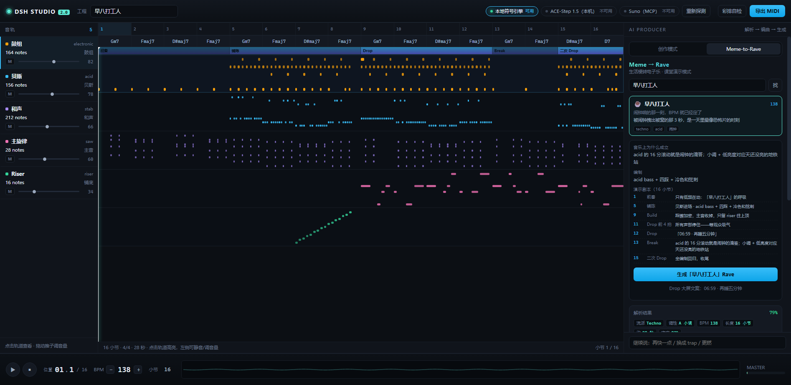
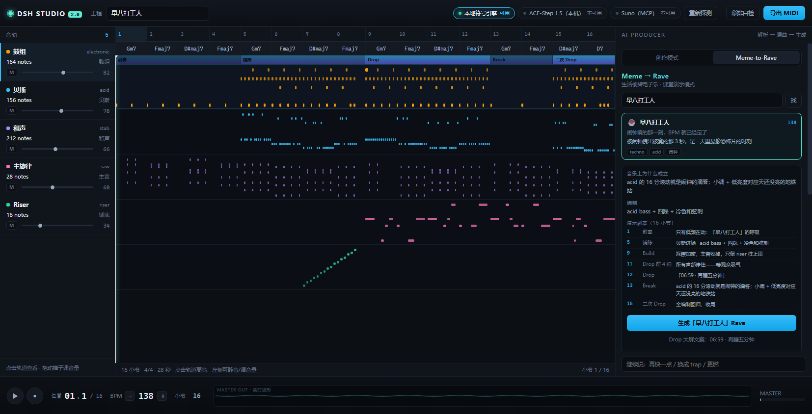
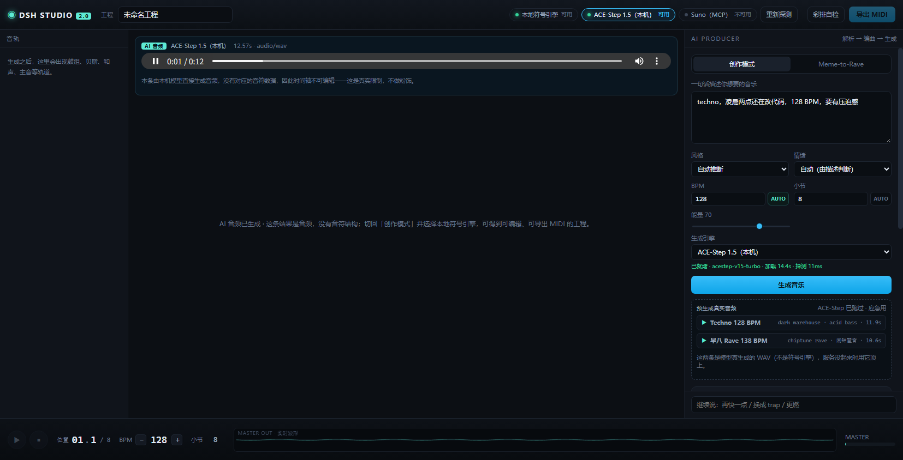
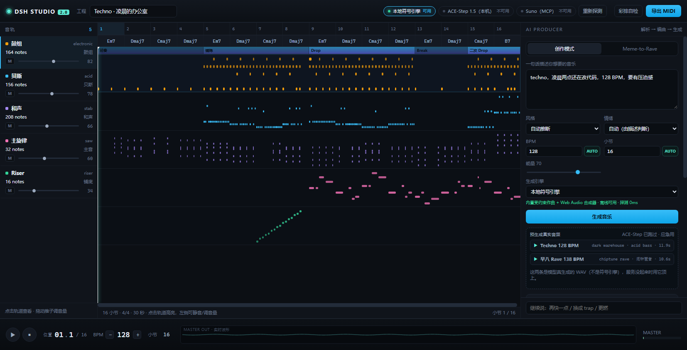
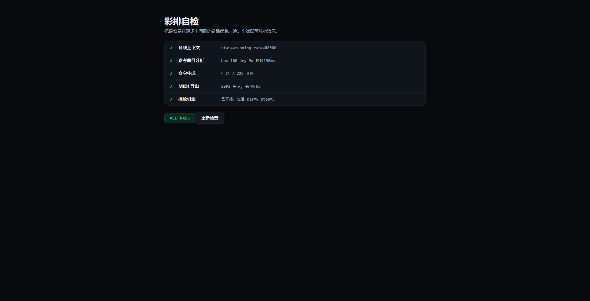

# DSH Studio 2.0 使用说明书

**版本**：2.0.0　　**适用平台**：Windows 10/11 + Chrome / Edge　　**最后更新**：2026-11-21

---

## 一、这是什么

DSH Studio 2.0 是一个**能在普通笔记本上运行、现场就能出声**的 AI 音乐工作站。你给它一句话或一个网络热梗，它给你一首有结构的电子乐，并且：

- **主旋律、贝斯、和声、鼓组、Riser 全部是音符**，不是一段黑盒音频，可以静音、调音量、导出 MIDI；
- 音色来自 **52 个自制 one-shot 采样**（48kHz/16bit，CC0），按 7 套 kit 随风格切换；
- 自带**双引擎**：算法作曲引擎（离线、毫秒级）与本机神经网络引擎（ACE-Step 1.5，生成真实音频）；
- 引擎状态**实时探测**：能用就显示可用，不能用就如实标灰，**不会拿算法结果冒充模型生成**。

### 能力边界（先讲清楚，避免误解）

| 能力 | 是否支持 | 说明 |
|---|---|---|
| 文字 → 可编辑工程（音符） | ✅ | 本地符号引擎，离线可用，可导出 MIDI |
| 文字 → 真实 AI 音频（WAV） | ✅ | 需本机 ACE-Step 服务在跑；输出 48kHz float32 音频 |
| 编辑 AI 音频里的音符 | ❌ | 音频没有音符结构，界面会明确写出这一点 |
| 音符级手动增删 | ⚠️ 部分 | 当前版本通过「静音 / 调音量 / 换引擎重新生成」调整，暂无逐音符画笔 |
| 导出 MIDI | ✅ | 标准 MIDI 文件（format 1，鼓走第 10 通道） |
| 导出 WAV | ❌ | 可用系统录音的方式录制播放 |
| 联网调用 Suno | ❌ | 未配置凭据，界面显示「不可用」 |

---

## 二、运行环境

| 项目 | 要求 |
|---|---|
| 操作系统 | Windows 10 / 11（本项目在 Windows 11 验证） |
| 浏览器 | Chrome 或 Edge（需要 Web Audio；Safari 未验证） |
| 显卡（可选） | NVIDIA，≥ 8GB 显存可跑 ACE-Step（实测峰值 4.45GB） |
| 磁盘 | 前端 + 素材约 20MB；ACE-Step 运行环境约 18.6GB |
| Python | 3.12（仅 ACE-Step 服务需要，路径已固定） |

> 前端本身不需要任何后端也能运行；只有「AI 音频」引擎依赖本机服务。

---

## 三、启动

### 3.1 一键启动（推荐）

双击项目根目录的 **`启动演示.bat`**。

它会依次：检查端口 → 启动 ACE-Step 服务（约 15 秒加载模型）→ 启动前端静态服务 → 轮询直到两者就绪 → 自动打开浏览器。

看到下面这段就表示可以用了：

```
   [OK] frontend ready : http://127.0.0.1:5173/
   [OK] ace-step ready : http://127.0.0.1:8000/health
   就绪！浏览器打开： http://127.0.0.1:5173/
```

### 3.2 手动启动（排查问题时用）

开两个终端：

```powershell
# 终端 1：AI 推理服务（必须是 Python 3.12）
D:\AI\ACE-Step-1.5\.venv\Scripts\python.exe D:\AI\aihw\.tmp\ace\serve.py

# 终端 2：前端
python -m http.server 5173 --bind 127.0.0.1 --directory D:\AI\aihw\dist
```

然后打开 `http://127.0.0.1:5173/`。

### 3.3 只开前端（不跑模型）

直接双击 **`dist\index.html`**。单文件版，JS/CSS 全部内联，`file://` 协议可直接运行，**不需要任何服务**。

此时 AI 音频引擎会显示不可用，但符号引擎、Meme-to-Rave、MIDI 导出、右侧「预生成真实音频」全部照常。

### 3.4 关闭

关掉两个命令行窗口（标题为「ACE-Step 服务」「DSH Studio 前端」）即可。模型与素材都留在磁盘上，**下次启动不会重新下载**。

---

## 四、界面导览



界面分五块：

| 区域 | 位置 | 作用 |
|---|---|---|
| **顶栏** | 最上方 | 工程名、三个引擎状态徽章、重新探测、彩排自检、导出 MIDI |
| **音轨列表** | 左 | 每条轨的名称、音符数、音色预设、静音（M）、音量推子 |
| **时间轴** | 中 | 小节尺、和弦轨、段落带、逐音符卷帘、播放头 |
| **AI Producer** | 右 | 描述输入、风格/情绪/BPM/小节/能量、引擎选择、解析结果、任务状态、对话流 |
| **传输条** | 底 | 播放/停止、小节.拍读数、BPM 增减、实时波形、主输出电平 |

### 顶栏的引擎徽章

三个徽章是**实时探测**结果，点击可切换引擎：

- 🟢 **本地符号引擎**——永远可用，离线、毫秒级
- 🟢 **ACE-Step 1.5（本机）**——服务就绪时可用，生成真实音频
- ⚪ **Suno（MCP）**——未配置凭据，固定不可用

点「**重新探测**」可重新检查（例如服务刚启动完、或你刚恢复了网络）。

---

## 五、快速上手（60 秒做一首）

1. 在右侧输入框写一句描述，例如：
   ```
   techno，凌晨两点还在改代码，128 BPM，要有压迫感
   ```
2. 风格 / 情绪保持「自动推断」；把「小节」设为 **8**（生成更快）。
3. 点 **生成音乐**。
4. 中间出现时间轴：鼓组、贝斯、和声、主旋律、Riser 五轨，上方是和弦（如 `Gm7 → Fmaj7`），彩色条带是段落（前奏 / 铺陈 / Drop / Break / 二次 Drop）。
5. 点底部 **▶** 播放。位置读数在走、示波器有波形。
6. 点右上 **导出 MIDI**，得到 `.mid` 文件。

---

## 六、创作模式详解

### 6.1 描述输入

一句话即可，写得越具体越准。支持的信号：

| 信号 | 例子 | 效果 |
|---|---|---|
| 流派 | `techno`、`house`、`dnb`、`trap`、`synthwave` | 决定鼓型、贝斯写法、音色 |
| BPM | `128 BPM`、`速度 140` | 覆盖推断值 |
| 小节数 | `16 小节`、`2 分钟` | 覆盖默认长度 |
| 调性 | `C 小调`、`F# minor` | 覆盖调式 |
| 能量 | `很燃`、`安静一点`、`炸` | 调整密度与 BPM |
| 情绪 | `深夜`、`下雨`、`通勤`、`毕业` | 影响调式、明暗、张力 |

### 6.2 参数区

| 控件 | 说明 |
|---|---|
| **风格** | 锁定流派；`自动推断` = 由描述决定 |
| **情绪** | 选中的情绪词会真的拼进解析文本，影响调式与速度 |
| **BPM** | 数字框可手填；右侧 `AUTO` 亮起表示由描述推断 |
| **小节** | 2–64；`AUTO` 同上。8 小节约 15 秒音频，生成更快 |
| **能量** | 0–100，越高鼓越密、Drop 越满 |

### 6.3 解析结果

生成后会显示一行 **chips**：流派 / 情绪 / 调性 / BPM / 长度 / 时长 / 密度，右上角是**置信度**。

下面每一条都是**推断理由**，例如：

- 命中流派关键词「Techno」→ 采用它的编制与鼓型
- 你指定了速度 128 BPM
- 默认 16 小节：足够走完「前奏 → 铺陈 → Drop → Break → 二次 Drop」

这是可解释的：你能看到"为什么是这首歌"，而不是一个黑盒结果。

### 6.4 任务状态

生成时按钮变「生成中…」，任务卡片列出各阶段与**实测耗时**（受约束作曲 / 段落编排 / 后端渲染）。没有人为 sleep，耗时为真实值。

### 6.5 追问（对话流）

底部输入框可以继续说话：

- `再快一点`、`换成 trap`、`更燃` —— 短句会与上一句描述合并后重新生成
- 长句会作为新的描述

每次生成都会在右侧留下回执，包括用了哪个引擎、耗时、以及一串说明。

---

## 七、Meme-to-Rave（热梗转舞曲）

点右侧 **Meme-to-Rave** 标签：



1. 输入热梗，例如 `早八打工人`、`老板画的饼`、`电子木鱼`、`整顿职场`。
2. 点 **找**。系统给出 1–3 张梗卡，每张包含：
   - 音乐化解读（这个梗为什么适合这种编制）
   - BPM / 标签
   - 一句话笑点
3. 点选一张卡，右侧展开：
   - **音乐上为什么成立**
   - **编制**（如 `acid bass + 四踩 + 冷色和弦刺`）
   - **16 小节演示剧本**（第几小节发生什么，可以照着讲）
4. 点 **生成「XXX」Rave**，走完整生成链路。

梗库里没有的词也不会空手：系统按文本指纹生成一个确定性方案（同一句话永远同一结果）。

---

## 八、播放与调整

| 操作 | 方式 |
|---|---|
| 播放 / 停止 | 底部 **▶ / ■**，或按 **空格键**（输入框聚焦时空格不会触发） |
| 看播放位置 | 传输条「位置 01.4 / 16」，小节.拍实时跳动 |
| 实时改 BPM | 传输条的 `−` / `+`；播放中会立即改速度 |
| 静音某轨 | 左栏点该轨的 **M**；再点恢复 |
| 调音量 | 左栏推子（0–140，右侧显示数值） |
| 选中/高亮轨 | 点左栏轨名或时间轴泳道 |
| 看波形 | 传输条中间的 **MASTER OUT · 实时波形**（limiter 之后的真实信号） |
| 看电平 | 右下 **MASTER** 条 |

> **为什么 Drop 前有一拍是静音的？** 那是编排：Drop 前留真空，砸下来才有冲击力。不是 bug。

---

## 九、AI 音频（ACE-Step）怎么用

1. 确认顶栏「ACE-Step 1.5（本机）」是**绿色**。
2. 生成引擎选它。
3. 点生成。约 10 秒后，时间轴上方出现蓝色 **AI 音频** 条，带播放器和时长。
4. 点播放即可听到模型生成的声音。



**重要提示**：这条音频**没有音符结构**，所以时间轴不可编辑，界面会明确写「本条由本机模型直接生成音频，没有对应的音符数据」。这是音频模型的本质，不是功能没做完。

如果你要的是"能改的音乐"，请切回**本地符号引擎**。

---

## 十、引擎不可用时会发生什么



- 徽章变灰，并写明原因（未检测到服务 / 加载中 / 模型初始化失败）
- 点生成会自动落到**本地符号引擎**，照样出可播放工程
- 页面**不会**出现伪造的"AI 音频"

手动兜底顺序：

1. 点「重新探测」（服务刚起来时常见）
2. 切「本地符号引擎」继续
3. 想看真实 AI 音频 → 右侧「**预生成真实音频**」→ 点两条 WAV 之一（离线可播）

---

## 十一、导出 MIDI

点右上 **导出 MIDI**，浏览器下载 `<工程名>.mid`。

- 格式：Standard MIDI File **format 1**
- 每件乐器一轨，鼓走**第 10 通道**
- 可直接拖进 Ableton Live / FL Studio / Cubase / Logic 继续做

---

## 十二、彩排自检

打开 `http://127.0.0.1:5173/?selftest=1`，会自动检查五项：



| 检查项 | 说明 |
|---|---|
| 音频上下文 | 浏览器是否允许 Web Audio |
| 参考曲目分析 | 现场合成一段 100 BPM / A 小调的 WAV 再解回来验证 |
| 文字生成 | 引擎是否产出合法 Song |
| MIDI 导出 | 生成的字节流头是否为 `MThd` |
| 播放引擎 | 是否真的开始播放 |

全绿即可上台。若「播放引擎」失败，通常是因为浏览器还没拿到用户手势——点一下页面再测。

---

## 十三、常见问题排查

| 现象 | 原因 | 处理 |
|---|---|---|
| 页面打不开 | 前端服务没起，或端口被占 | 看「DSH Studio 前端」窗口是否还在；或改端口（见下） |
| ACE 徽章一直是灰的 | 服务没起 / 模型还在加载 | 等 15–20 秒点「重新探测」；看 ACE 窗口是否报错 |
| 生成时提示 503 | 服务在跑但模型未就绪 | `http://127.0.0.1:8000/health` 看 `status`；不是 `ready` 就再等 |
| 完全没有声音 | 浏览器要求用户手势 | 先点一下页面任意处，再点播放 |
| 音频条出现但点播没反应 | 浏览器拦截了自动播放 | 同上；或直接点播放器控件 |
| 生成很慢 | 请求时长太长 | 把「小节」改成 8；或换符号引擎 |
| 中文显示成方块 | 系统缺字体 | 安装「微软雅黑」；投影电脑常见 |
| 提示端口被占用 | 上一次的服务没关干净 | 关掉旧窗口，或改端口（见下） |
| 控制台出现乱码 | Windows 控制台代码页问题 | 不影响功能 |

### 改端口

- 前端：启动命令里把 `5173` 换成别的端口，浏览器地址同步改
- 推理服务：修改 `.tmp\ace\serve.py` 末尾 `uvicorn.run(..., port=8000)`，同时改 `src\engine\backends.ts` 里的 `ACE_BASE`
- 改完需要重新构建前端：`npm run build:file`

### 怎么确认服务活着

```powershell
# 应返回 {"status":"ready", ...}
curl.exe http://127.0.0.1:8000/health

# 应返回 200
curl.exe -I http://127.0.0.1:5173/
```

---

## 十四、文件与数据

| 路径 | 作用 |
|---|---|
| `dist\index.html` | 前端单文件版（可直接双击） |
| `src\` | 前端源码（TypeScript / React） |
| `demo\`、`dist\demo\` | 两条预生成的真实音频 |
| `.tmp\ace\serve.py` | 本机 ACE-Step 推理服务 |
| `.tmp\ace\models\` | 模型权重（9.4 GB，**不要删**，删了要重下） |
| `.tmp\ace\logs\` | 服务日志 |
| `scripts\` | 构建、测试、验收脚本 |
| `_backup\` | 改造前的源码备份 |

**磁盘占用**：`.tmp\ace` 约 18.6 GB。其中 `dl\`（wheel 缓存 3.05 GB）与未使用的 `acestep-5Hz-lm-1.7B`（3.5 GB）可以安全删除，回收约 6.6 GB。

---

## 十五、快捷键

| 键 | 作用 |
|---|---|
| `空格` | 播放 / 停止（焦点不在输入框时） |
| `Ctrl + Enter` | 在描述框里直接触发生成 |
| `Enter` | 在追问框里发送追问 |
| `Esc` | 关闭浏览器全屏（若用了全屏） |

---

## 十六、已知限制

- AI 音频**不能**在时间轴上编辑（音频无音符结构，界面已标注）
- 暂无逐音符画笔编辑、撤销栈、自动化曲线、多轨录音
- 旋律采用「动机 + 变奏」，撑不起完整发展部
- 模型对请求时长不精确：请求 14 秒可能只有 11–12 秒有内容，服务端已做**尾部静音裁剪**
- 一次只处理一个生成请求（服务端串行）
- Suno 通道未配置，固定不可用

---

## 附录 A：HTTP 接口（供二次开发）

| 接口 | 方法 | 说明 |
|---|---|---|
| `/health` | GET | `{status: ready\|loading\|error, model, quantization, load_seconds, uptime_seconds}` |
| `/generate` | POST | 入参 `{prompt, duration, bpm, steps, seed}`；返回 `{audio_url, duration, generate_seconds, peak_vram_gb}` |
| `/audio/<name>.wav` | GET | 音频字节流 |

请求示例：

```powershell
$body = @{ prompt = 'dark techno, 128 bpm'; duration = 12; bpm = 128 } | ConvertTo-Json
Invoke-RestMethod -Uri http://127.0.0.1:8000/generate -Method Post `
  -ContentType 'application/json' -Body $body
```

## 附录 B：术语

| 术语 | 含义 |
|---|---|
| 符号引擎 | 用乐理规则生成音符（MIDI 数据），由 Web Audio 播放 one-shot 采样（2.2 起） |
| 神经引擎 | ACE-Step 模型直接生成音频波形（WAV） |
| Drop | 电子乐中能量最高、全编制进入的段落 |
| 编排 | 决定哪个声部在哪个小节进入/退出 |
| 回退 | 引擎不可用时自动降级到可用引擎，并如实标注 |
| 分段调度 | 播放器每个小节读取最新曲谱，改动下一小节即生效 |

---

**技术支持**：项目根目录 `README.md`、`现场演示操作卡.md`、`交付报告.pdf`。
