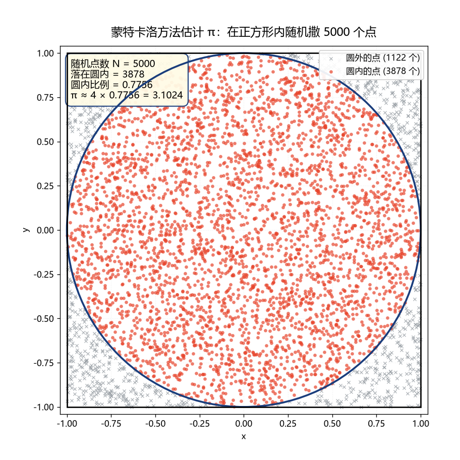
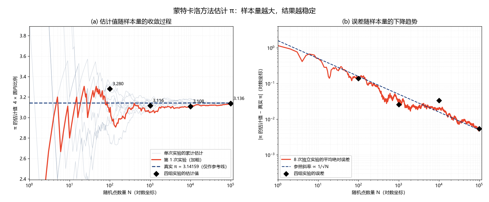

# 用随机实验估计圆周率 π —— 蒙特卡洛方法数学实验

> **实验环境**：Python 3.14 + NumPy 2.5.3 + Matplotlib 3.11.2
> **实验脚本**：`monte_carlo_pi.py`（随机种子固定为 2025，结果可复现）
> **实验区域**：边长 2 的正方形 `[-1, 1] × [-1, 1]`，内接半径 1、圆心在原点的单位圆 `x² + y² ≤ 1`

---

## 一、为什么这个方法能够估计 π

### 1.1 核心思路：把「面积之比」换成「数点之比」

先看两个**确定的**几何事实（这里完全没有用到 π 的数值）：

| 图形 | 面积 |
|---|---|
| 正方形 `[-1,1] × [-1,1]` | 边长 × 边长 = 2 × 2 = **4** |
| 单位圆 `x² + y² ≤ 1` | 圆的面积公式 = **π × 1² = π** |

于是圆的面积占正方形面积的**比例**是：

$$\frac{\text{圆面积}}{\text{正方形面积}} = \frac{\pi}{4}$$

注意：上面的 π 是一个**符号**，我们只用它表示"圆的面积是多少"这件事，**并不需要知道它等于 3.14159…**。这一步只是把"π 是多少"这个未知数，和"比例是多少"这个同样未知的量挂上了钩。

### 1.2 关键的一步：均匀撒点时，「点的比例」会模仿「面积的比例」

现在闭上眼睛想象这样一个动作：**往正方形里随机撒一把沙子**（或者说蒙着眼睛往正方形靶子上扔飞镖）。

"随机"在这里有一个明确的含义：**每一个点落在正方形内任何一个小区域的可能性，都和那个小区域的面积成正比**，而且每个点落在哪里互不影响。也就是说，点不会"偏爱"正方形的某些位置。

这样一来：

- 一个随机点落在**圆内**的可能性，正比于圆的面积；
- 一个随机点落在**圆外**（正方形内）的可能性，正比于正方形面积减去圆面积；
- 两者相比，正好就是面积之比。

用一句朴素的话概括：

> **撒的点足够多时，落在圆内的点的比例，就会接近圆的面积比例。**

如果只是一把沙子随手一撒，比例当然不准；但只要撒得足够多，**点的密度在正方形里趋于均匀**，比例也就越来越可信。这就是整个方法的全部道理。

### 1.3 把比例反过来解出 π

设一共撒了 `N` 个点，其中有 `M` 个落在圆内，那么：

$$\frac{M}{N} \approx \frac{\text{圆面积}}{\text{正方形面积}} = \frac{\pi}{4}$$

把等式两边同时乘以 4，就把 π"解"出来了：

$$\boxed{\;\pi \approx 4 \times \frac{M}{N} = 4 \times \frac{\text{落在圆内的点数}}{\text{随机点总数}}\;}$$

整个推理链条中，我们**从头到尾没有使用 π 的数值**：我们只知道"圆的面积是 π"，然后靠撒点把 π/4 这个比例"测"出来。真实的 π 只在最后一步用来检查我们测得准不准。

### 1.4 一个能自己动手的类比

拿一张白纸画一个正方形，在正方形里画一个内切圆（就像本实验的图形）。然后**闭着眼睛往纸上撒 100 粒米**，数一数有多少粒落在圆的里面。假设有 78 粒：

```
π ≈ 4 × 78 / 100 = 3.12
```

你并没有"计算"π，你只是**数了数米粒**，就得到了 π 的一个粗糙估计。这就是蒙特卡洛方法（Monte Carlo method）最朴素的样子。

---

## 二、四组实验的结果

按题目要求分别做了 4 组**相互独立**的随机实验（每组使用不同的随机种子）。

> 真实值 π ≈ **3.1415926536**，仅在计算误差时使用。

| 随机点数 N | 圆内点数 M | 圆内比例 M/N | **π 估计值 = 4M/N** | **绝对误差** | **相对误差** |
|---:|---:|---:|---:|---:|---:|
| 100 | 82 | 0.82000 | **3.28000** | 0.13841 | 4.406% |
| 1 000 | 779 | 0.77900 | **3.11600** | 0.02559 | 0.815% |
| 10 000 | 7 771 | 0.77710 | **3.10840** | 0.03319 | 1.057% |
| 100 000 | 78 406 | 0.78406 | **3.13624** | 0.00535 | 0.170% |

（圆外点数分别为 18、221、2 229、21 594，M + 圆外点数 = N。数据同时保存在 `monte_carlo_results.csv`。）

### 2.1 结果观察

**观察一：N 越大，估计值总体上越接近 π。**
N = 100 时估计值是 3.280，误差高达 0.138（相对误差 4.4%）；N = 100 000 时估计值是 3.13624，误差只有 0.0054（相对误差 0.17%）。

**观察二：单次实验的误差并不是"单调下降"的。**
N = 10 000 的误差（0.03319）反而略大于 N = 1 000 的误差（0.02559）。这**完全正常**，并不是程序出错：

- 每一次实验都是"重新撒一把点"，点的位置是随机的，所以误差本身也带随机性；
- 样本量增大只是让**误差变小的趋势**更明显，并不能保证每一步都恰好比上一组更准；
- 就像抛硬币：抛 10 次可能出现 7 次正面，抛 100 次却只出现 46 次正面——次数多并不保证每一步都更"完美"。

**观察三：从整体跨度看，误差确实按"1/√N"的规律缩小。**
N 从 100 增加到 100 000，点数扩大了 1000 倍，误差从 0.13841 降到 0.00535，缩小了约 **26 倍**；而理论预期 1/√1000 ≈ 0.0316，即应缩小约 **32 倍**。两者量级一致。

**观察四：用多次重复实验的平均误差来看，趋势就非常干净了。**
把每组实验独立重复 8 次（即做 8 条完整的长实验序列，在每个 N 处统计）：

| N | 8 次实验的平均估计值 | **平均绝对误差** | 最大绝对误差 | 最小绝对误差 |
|---:|---:|---:|---:|---:|
| 100 | 3.09000 | **0.14540** | 0.38159 | 0.02159 |
| 1 000 | 3.11050 | **0.03269** | 0.09759 | 0.00159 |
| 10 000 | 3.14420 | **0.02070** | 0.04241 | 0.00241 |
| 100 000 | 3.13736 | **0.00496** | 0.01131 | 0.00003 |

平均绝对误差 0.1454 → 0.0327 → 0.0207 → 0.0050，**单调下降**，这就是"样本量越大越准"的可靠证据。
（数据保存在 `monte_carlo_convergence.csv`。）

---

## 三、Python 实验方法

### 3.1 程序结构

脚本 `monte_carlo_pi.py` 分为五个部分：

| 部分 | 作用 |
|---|---|
| `monte_carlo_pi(n, rng)` | **核心函数**：撒 n 个点、统计圆内点数、算出 π 估计值 |
| `run_experiments()` | 完成 N = 100 / 1000 / 10000 / 100000 四组实验并记录结果 |
| `save_csv()` / `save_convergence_stats()` | 把结果和重复实验统计写入两个 CSV 文件 |
| `plot_demo()` | 绘制第一幅图 `monte_carlo_pi.png` |
| `plot_convergence()` | 绘制第二幅图 `pi_convergence.png` |

### 3.2 核心代码只有四行

```python
x = rng.uniform(-1.0, 1.0, n)        # 在 [-1,1] 上随机生成 n 个 x 坐标
y = rng.uniform(-1.0, 1.0, n)        # 在 [-1,1] 上随机生成 n 个 y 坐标
inside = (x * x + y * y) <= 1.0      # 判断每个点是否落在单位圆内
pi_hat = 4.0 * np.count_nonzero(inside) / n   # 关键公式 π ≈ 4 × 圆内比例
```

这就是全部：**生成随机点 → 判断是否在圆内 → 数数 → 乘 4**。

### 3.3 两个实验细节

1. **随机数发生器**：使用 NumPy 的 `default_rng(seed)`。每组实验给不同的种子，保证四组互相独立；同时固定种子使结果**可复现**（任何人运行脚本都会得到上表完全相同的数字）。
2. **π 的使用位置**：程序里只出现一行 `PI_TRUE = math.pi`，它仅在**计算误差**和**画参考线**时被调用，绝不参与任何撒点与估计过程。这一点在代码注释中做了明显的标注。

### 3.4 运行方式

```bash
python monte_carlo_pi.py
```

运行后会在脚本所在目录生成 5 个文件（2 幅图 + 2 个数据文件 + 本报告）。

---

## 四、两幅图的解释

### 4.1 第一幅图：`monte_carlo_pi.png`（随机点的分布）



- **画了什么**：用 N = 5000 个随机点填满正方形，**红色的实心圆点**表示落在圆内的点（3878 个），**灰色的小叉**表示落在圆外的点（1122 个），蓝色粗线是单位圆边界，黑色方框是正方形边界。
- **看图要点**：
  - 红点密密麻麻地正好"铺满"圆的内部，灰叉则只出现在四个角上的月牙形区域——这说明**点的密度在正方形内是均匀的**，圆内之所以点多，纯粹是因为圆内的**面积大**。
  - 四个角落的月牙区域（圆外部分）面积占比看起来大约是 1/5 左右，与 1 − π/4 ≈ 0.215 相符。
- **结果**：本次实验落在圆内的比例是 0.7756，因此

  $$\pi \approx 4 \times 0.7756 = 3.1024$$

  这个估计值直接标注在图中的黄色文本框内（文本框只报告"数出来的结果"，没有引用真实 π）。
- **直观感受**：5000 个点已经能看出圆的形状，但点的分布仍然带有明显的"颗粒感"——这种不均匀正是估计误差的来源。

### 4.2 第二幅图：`pi_convergence.png`（估计值随 N 的变化）



这幅图由两个子图组成。

**子图 (a)：估计值随样本量的收敛过程**

- **横坐标**：随机点数量 N（用**对数坐标**，这样从 1 到 100 000 的整个变化过程都能看清）；
- **纵坐标**：π 的估计值 `4 × 圆内比例`；
- **蓝色虚线**：真实 π = 3.14159…（只作参考线）；
- **浅灰色细线**：8 次独立实验各自的"累计估计值"曲线（即每撒一个点就更新一次估计值）；
- **红色粗线**：其中第 1 次实验，加粗突出；
- **黑色菱形**：第二节表格中四组实验的估计值（3.280 / 3.116 / 3.108 / 3.136）。

**从图上能看到什么**：

1. **N 很小时曲线剧烈翻滚**：N < 100 的区间，估计值在 2.4 到 3.8 之间大幅跳动。因为点数少时，多一个点或少一个点都会显著改变比例。
2. **N 增大后曲线迅速收拢到参考线附近**：到 N ≈ 1000 时各条曲线已经都挤在 3.0 ~ 3.25 的窄带里；到 N = 100 000 时几乎重合在 3.14 附近。
3. **8 条曲线的分散程度随 N 明显减小**：这正是"随机性带来的不确定性在缩小"的可视化。

**子图 (b)：误差随样本量的下降趋势**

- **横坐标**：N（对数坐标）；**纵坐标**：|估计值 − 真实 π|（对数坐标）；
- **红色实线**：8 次独立实验的**平均绝对误差**；
- **蓝色虚线**：参照斜率 ∝ 1/√N；
- **黑色菱形**：四组实验的误差。

**从图上能看到什么**：

1. 平均绝对误差随着 N 增大而稳定下降，从 N = 1 时的约 1.0 降到 N = 100 000 时的约 0.005；
2. 红色曲线的斜率与蓝色虚线（1/√N）**基本平行**，说明误差确实按"与 √N 成反比"的规律缩小；
3. 曲线在局部有起伏（锯齿），说明**单次实验的误差有随机波动**，只有看平均值时趋势才清晰；
4. 黑色菱形对应的单次实验结果上下跳动，再次印证了第二节"观察二"的结论。

**一个重要的代价**：因为误差 ∝ 1/√N，想让误差再缩小 10 倍，就必须把点数增加 **100 倍**。所以图 (b) 的横轴要用对数坐标——否则 N = 100 000 会把前面的变化全部压在图的左边一小段里。

---

## 五、最终结论

1. **方法有效**：通过"在正方形内均匀撒随机点、数圆内点数、乘以 4"这一简单规则，程序在不使用 π 数值的前提下，用 100 000 个随机点把 π 估计到了 **3.13624**，绝对误差仅 **0.0054**，相对误差 **0.17%**。

2. **方法原理**：成立的关键是面积比 `圆面积 : 正方形面积 = π : 4`。均匀随机点的"点的比例"会模仿"面积的比例"，所以 `圆内比例 ≈ π/4`，反解即得 `π ≈ 4 × 圆内比例`。整个推导只用到圆的面积公式这一**符号关系**，不需要 π 的数值。

3. **误差规律**：样本量从 100 增加到 100 000（×1000），误差缩小约 26 倍，与 1/√N 预期的约 32 倍量级一致；8 次重复实验的平均绝对误差从 0.1454 降到 0.00496，单调下降。

4. **方法的性格**：这个方法的优点是**简单、通用、几乎不需要任何数学技巧**，只要能把问题写成一个"比例"就能用；缺点是**收敛慢**，精度每提高一个数量级就要多花 100 倍的点数。它属于"用计算量换数学难度"的思路。

5. **实验印证了理论**：两幅图分别从"空间分布"和"收敛过程"两个角度，直观展示了随机采样如何把一个几何常数"测"出来，以及为什么样本越多、结果越可靠。

---

## 六、为什么这个实验很有意思？

### 6.1 随机的实验，凭什么能解决确定性的数学问题？

π 是一个非常**确定**的数——它不会因为今天是星期几而改变，它就在那里，精确到无限多位。可我们居然用"随机撒点"这种看起来最不靠谱的办法把它测了出来。这看似矛盾，其实有一个很清爽的解释：

> **随机只是手段，不是目的。**

我们真正做的事情是：**把"求面积"这个几何问题，偷换成了"数数"这个算术问题。**

数数是计算机最擅长的事。我们不需要知道怎么算圆的面积，只需要会判断"一个点是不是在圆里"——而这个判断只要比较 `x² + y²` 和 1 的大小，是初中数学。于是：

```
"圆有多大？"  →  "撒一堆点，数数有多少个落在里面"
```

随机性在此扮演的角色，是**保证点撒得足够均匀**。只要均匀，点的疏密就能代表面积的大小。所以这里的随机不是"碰运气"，而是一种**均匀取样的工具**：它把连续的、需要用微积分处理的面积问题，变成了离散的、只需要加减乘除的计数问题。

一个更生活的类比：想知道一个省份里森林面积占多少，不必去测量每一片树林的边界——只要在卫星图上**随机撒 10 万个点**，看看有多少个点落在林地上就行了。这就是"随机采样式测量"。

### 6.2 为什么随机点越多，通常结果越接近 π？

想象每个点都是一次"小投票"：它投给"圆内"或者"圆外"。单个点的投票结果完全是随机的，谁也说不准；但当投票的人足够多时，**结果会稳定在一个固定的比例上**。

关键原因有两条：

**第一，多出来的点会互相"抵消"。**
点数少的时候，偶然性很容易被放大。比如 N = 100 时，只要多 5 个点落在圆内，圆内比例就从 0.775 变成 0.825，π 的估计值立刻从 3.10 跳到 3.30——一次"运气"就能造成 0.2 的误差。而当 N = 100 000 时，多 5 个点对比例的影响只有 0.00005，几乎看不见。点数越多，"运气"造成的偏差就越难掰动整体的比例。

**第二，误差的缩小速度是 1/√N。**
这可以用一个直观的方式理解：N 个点的误差有正有负，它们相加时会互相抵消一部分。抵消之后剩下的净误差，量级大致是 **√N**，而它相对于总数 N 的比例就是 `√N / N = 1/√N`。所以：

| 想让误差缩小到 | 需要点数增加 |
|---|---|
| 1/2 | 4 倍 |
| 1/10 | 100 倍 |
| 1/100 | 10 000 倍 |

这个规律也解释了实验中的一个现象：**单次实验的误差不是单调下降的**（本实验里 N = 10 000 的误差反而比 N = 1 000 略大）。因为每一组实验都是重新撒点，误差本身就带随机性。样本量大只是让"误差变小的趋势"更明显，并不保证每一步都更准——就像抛硬币，抛 10 次出现 7 次正面，抛 100 次却可能只出现 46 次。

### 6.3 这种思想和计算机模拟有什么关系？

这个实验是**蒙特卡洛方法**（Monte Carlo method，以著名的赌城命名）最经典的入门例子。它的思想配方只有三步：

1. 把要求的东西写成一个**比例**或**平均值**（这里是"圆内点的比例"）；
2. 用计算机大量地**随机模拟**（撒点）；
3. 用模拟得到的**频率**去近似那个比例。

计算机每秒能生成上亿个随机数，"撒点"对它来说毫不费力，于是这个思路在现代科学技术里几乎无处不在：

- **物理与工程**：模拟中子穿过屏蔽层、核反应堆中的粒子输运——粒子的每次碰撞都是随机的，正好适合这种"模拟真实随机过程"的方法；
- **金融**：给复杂的期权定价，本质上是在模拟成千上万条可能的价格走势；
- **芯片与可靠性设计**：随机生成工艺偏差，看看电路还能不能正常工作，估计失效概率；
- **计算机图形学**：电影里逼真的光照渲染（路径追踪），是让光线在场景里随机弹射几百万次再统计亮度；
- **人工智能**：这是和我们这门课最直接的联系——
  - 训练神经网络时的**随机初始化、随机打乱数据、Dropout**，都依赖随机性；
  - **随机梯度下降（SGD）** 每次只随机抽取一小批样本，用它来估计"整个数据集上的梯度方向"——这和本实验"用一部分随机点的比例估计整体的比例"是**完全同一个思想**；
  - **强化学习**中智能体要"随机探索"未知动作，才能发现更好的策略；
  - **生成模型**（如扩散模型）从随机噪声出发，一步步"去噪"生成图像。

所以这个撒点求 π 的小实验，虽然稚气，却包含了整个随机模拟世界的种子：**当精确计算太困难时，我们可以造一个随机的"虚拟世界"，让它在计算机里跑很多遍，然后从统计结果里读出答案。**

### 6.4 最后一点感想

这个实验还打破了一个常见的印象：**"确定性"和"随机性"是对立的**。

恰恰相反——π 是最确定的数学常数之一，而估计它的最好用、最通用的办法之一，居然是制造随机性。随机性不是混乱，它是一种**可以控制的、有规律的不确定性**：单看一个点，你完全无法预测；但看一百万个点，规律就浮现出来了。这种"个体不可预测、整体有稳定规律"的现象，正是概率与统计这门学科，也是现代人工智能许多方法的立足点。
